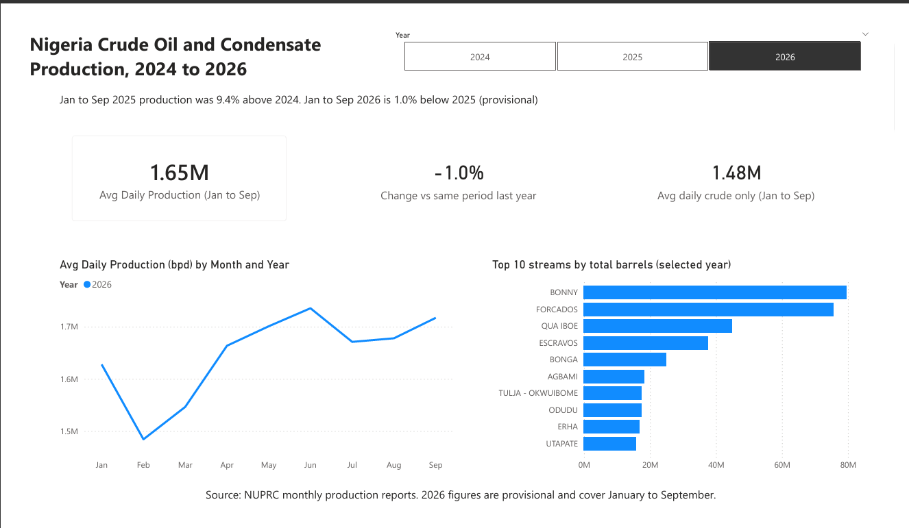
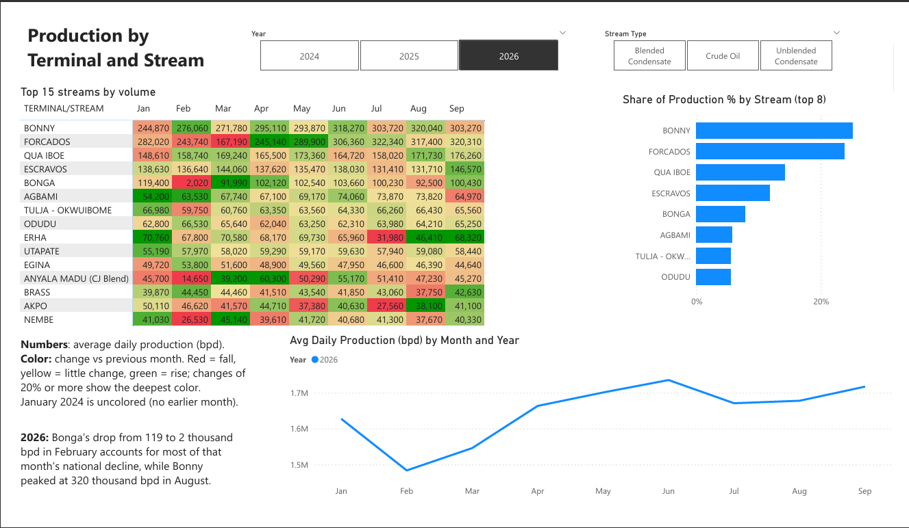

# Nigeria Crude Oil and Condensate Production Dashboard (2024 to 2026)

An interactive Power BI dashboard analysing Nigeria's monthly crude oil and
condensate production, built from NUPRC's published reports.

## Question
How has Nigeria's oil production changed since 2024, and which terminals and
streams drive those changes?

## Key findings
- Average daily production from January to September 2025 was **9.4% above**
  the same period of 2024 (about 1.52M to 1.66M barrels per day).
- January to September 2026 averages about 1.65M bpd, **1.0% below 2025**.
  2026 figures are provisional.
- Bonga's output fell from 119.4 to 2.0 thousand bpd in February 2026 and
  accounts for most of that month's national decline. The report gives no
  reason, so the dashboard shows it as reported.
- Bonny reached its 2026 peak of 320 thousand bpd in August.
- Bonny and Forcados were the two largest streams in every year analysed
  (2024, 2025 and January to September 2026), Together, they supplied about
  [49.1%] of production in 2026.

## What the dashboard contains
- **Overview:** headline cards, monthly trend by year, top 10 streams by volume
- **Terminals:** a matrix of streams by month, coloured by month-on-month change,
  with a stream trend chart and share of production
- **About This Data:** sources, cleaning steps and validation

## Data
Source: NUPRC monthly crude oil and condensate production reports (PDF),
January 2024 to September 2026: (https://www.nuprc.gov.ng/reports/oil-production-report).
2026 figures are provisional.

## Method (summary)
1. Extracted tables from the PDFs with Power Query
2. Cleaned merged cells, subtotals, watermark text and dashes
3. Converted 2026 data from thousand barrels per day to monthly barrels
4. Standardised stream names across years
5. Built a date table and DAX measures for totals, daily averages and
   year-on-year change (same months in each year)

Full details are in [NOTES.md](NOTES.md).

## Validation
Monthly totals for 2024 and 2025 match NUPRC's published totals exactly.
2026 daily averages match within 0.01 to 0.02 thousand bpd, due to NUPRC
rounding each stream before summing.

## Tools
Power BI Desktop, Power Query, DAX

## Files
- `dashboard/`: the Power BI file and a PDF export
- `images/`: screenshots
- `NOTES.md`: detailed method notes

## Author
Joshua Ebiai, geology graduate | [www.linkedin.com/in/joshua-ebiai-767917285].
